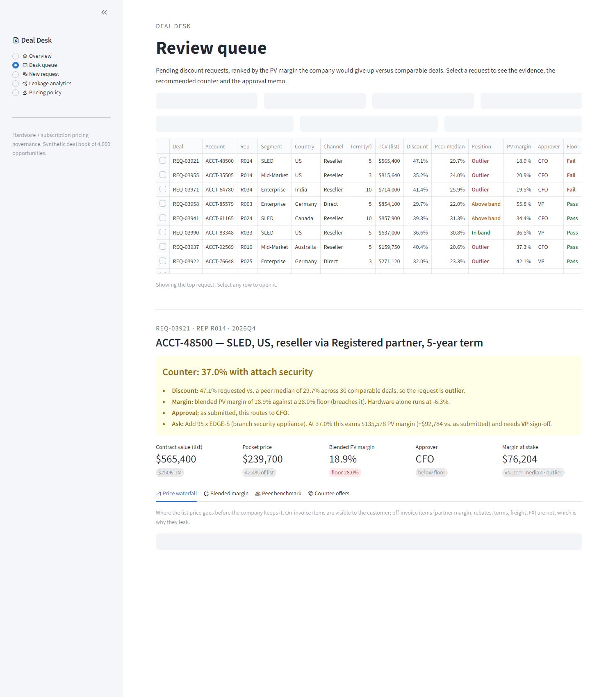
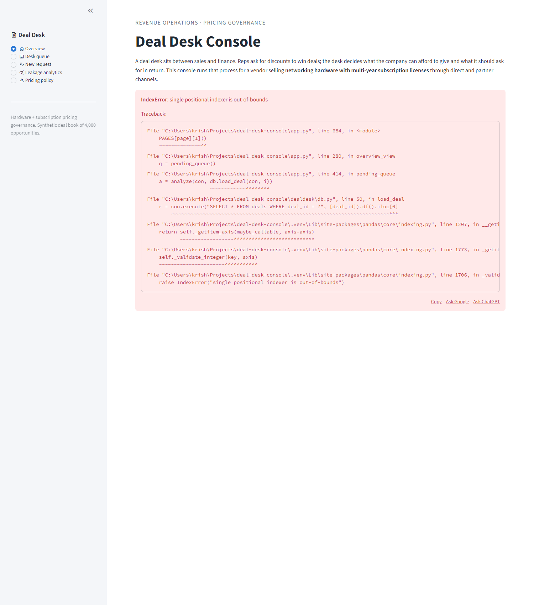
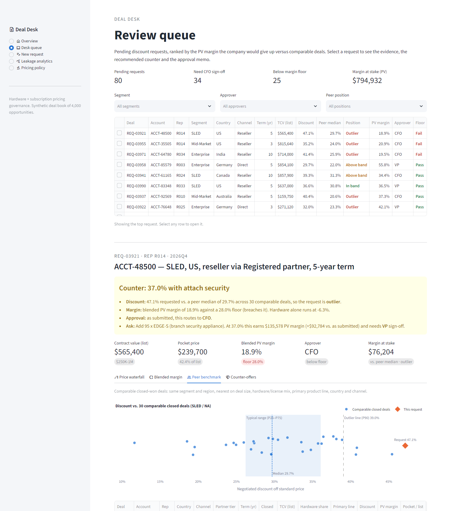
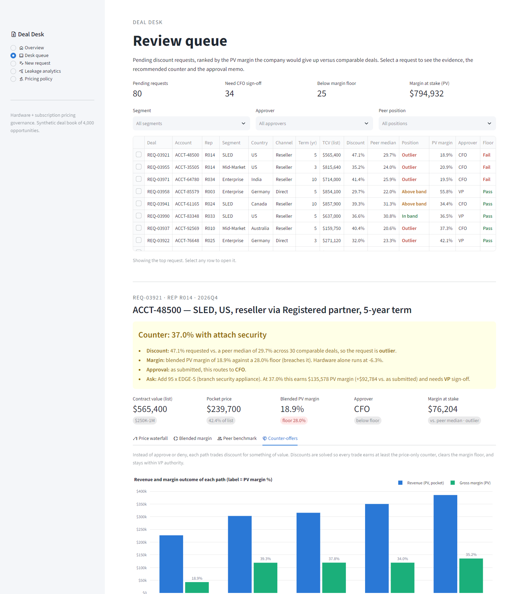
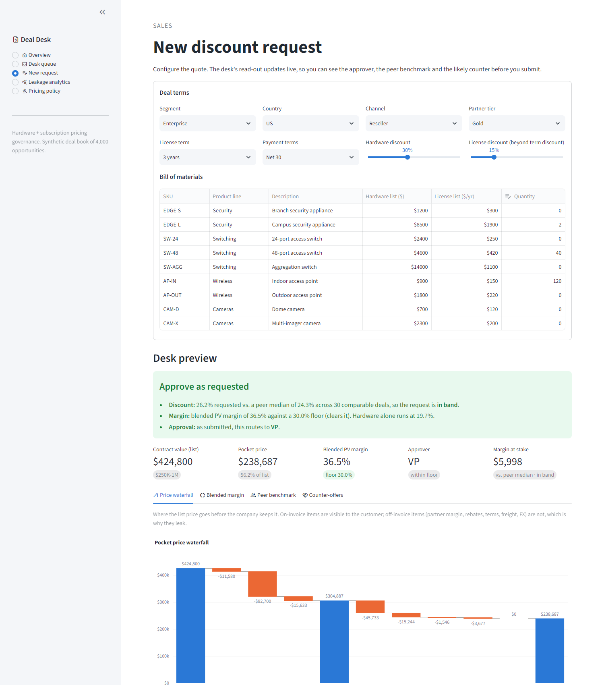
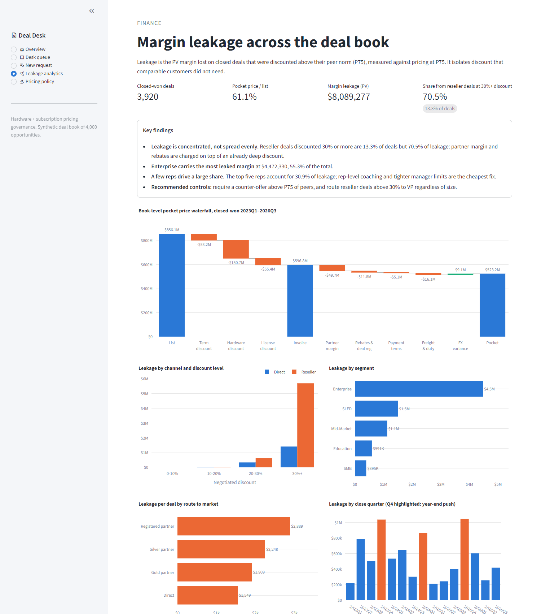
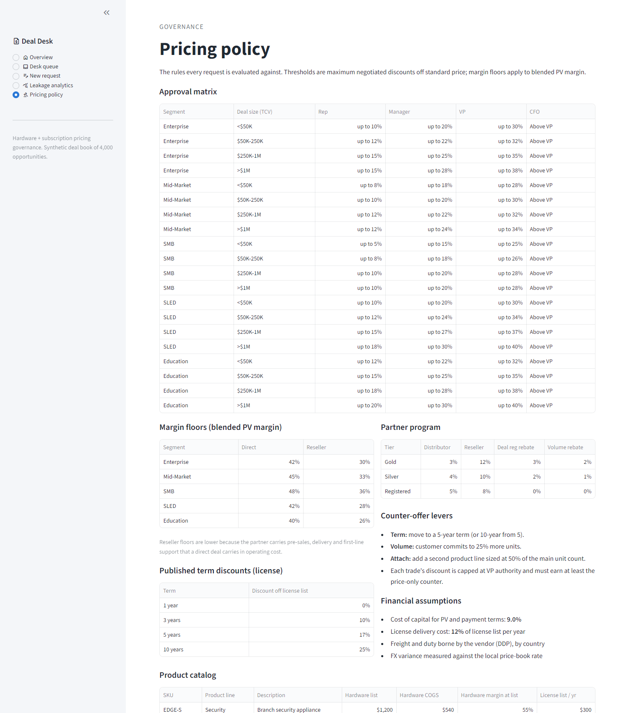
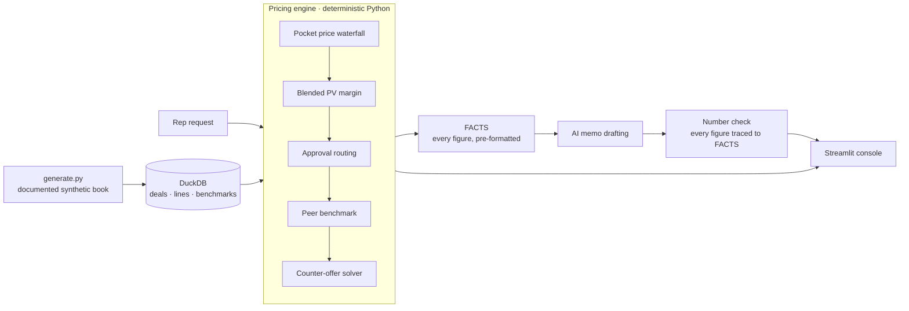

# Deal Desk Console

**Margin and discount governance for hardware + subscription deals.**

A deal desk sits between sales and finance. Reps ask for discounts to win deals. The desk decides what the company can afford to give, and what it should ask for in return. This project is a working deal desk for a vendor that sells networking hardware with multi-year subscription licenses through direct and partner channels:

- a deterministic pricing engine that turns each discount request into a decision, with the evidence behind it
- a Streamlit console for reps and the desk
- an approval memo drafted by an AI model from the engine's figures



---

## The business problem

| Problem | What the console does |
|---|---|
| **The headline discount hides the real price.** After partner margin, rebates, payment terms, freight, duty and FX, the company keeps far less than the invoice suggests. | A **pocket price waterfall** for every deal, from list price to what the company actually keeps. |
| **Hardware and license margins get traded.** Reps give away hardware margin up front and point to a long license term to justify it. | A **blended margin model** in present value, plus a term-trade table. For each term it shows the hardware discount at which the license tail actually pays back the concession. |
| **Approval is inconsistent.** Similar deals get very different discounts, depending on who asks and when. | An **approval routing matrix** (segment × deal size → Rep / Manager / VP / CFO) with a margin floor, and a **peer benchmark** against the 30 most comparable closed deals. |
| **"Approve or deny" leaves money on the table.** | A **counter-offer recommender**: hold the discount if the customer extends the term, commits to volume, or adds a product line. Each path is priced. |

## Findings on the deal book

The synthetic book holds 3,920 closed-won deals (2023Q1 to 2026Q3) and 80 pending requests.

- **61.1%** of list value is realised as pocket price. The largest single deduction is the negotiated hardware discount: $150.7M of $856.1M list.
- **$8.09M** of PV gross margin leaked through discounts above the peer norm. That is measured on deals priced above their peer P75, against repricing them at P75.
- **70.5%** of that leakage sits in **reseller deals at 30%+ discount**, which are only **13.3%** of deals. Partner margin and rebates are charged as a percentage of an already discounted invoice, so these deals end up furthest outside their peer bands.
- The top five reps account for **31%** of leakage, and Q4 leakage runs well above other quarters.

> The data is synthetic. Every distribution, including the extra discount pressure on reseller deals, is documented in [docs/DATA.md](docs/DATA.md). The engine is what this project demonstrates: it measures leakage, locates it and prices it deal by deal on any book with the same schema.

## Console

| | |
|---|---|
| **Overview.** Business context, book-level KPIs and how a request is evaluated. |  |
| **Review queue.** Pending requests ranked by margin at stake, with a plain-English decision brief, the full evidence, the approval memo and a decision log. |  |
| **Counter-offers.** Revenue and margin outcome of each trade, with the recommended path. |  |
| **New request.** A rep builds the quote and sees the desk's read-out live before submitting. |  |
| **Leakage analytics.** Key findings, a book-level waterfall, and leakage by channel, discount level, segment, partner tier, quarter and rep. |  |
| **Pricing policy.** Approval matrix, margin floors, term discounts, partner program and product catalog. |  |

## How it works



### Pricing engine (`dealdesk/`)

**Pocket price waterfall** ([economics.py](dealdesk/economics.py)). This follows Marn and Rosiello's pocket price framework:
- List price, less the published term discount and the negotiated hardware and license discounts, gives the **invoice price**.
- From there come partner margin (distributor plus reseller), rebates and deal registration, the cost of payment terms, freight and duty (DDP), and FX variance against the price-book rate.
- What remains is the **pocket price**.

**Blended PV margin.**
- Hardware margin is booked at signing.
- License revenue and delivery cost are billed annually in advance over the term, discounted at a 9% cost of capital.
- The term trade solves, for each term, the hardware discount at which the deal earns the same PV margin as the request.

**Approval routing** ([routing.py](dealdesk/routing.py)).
- Each segment and deal-size band has the most a Rep, Manager or VP can approve. Anything above goes to the CFO.
- Each segment has separate direct and reseller margin floors. A deal below its floor needs a CFO exception, whatever its discount.

**Peer benchmark** ([db.py](dealdesk/db.py), [analysis.py](dealdesk/analysis.py)).
- Peers must be in the same segment and region.
- Among those, the 30 nearest closed deals are picked by distance on log deal size, hardware/license mix, primary product line, country and channel.
- P25–P75 is the normal range, and above P90 is an outlier.
- Margin at stake is the PV margin given up against pricing at the peer median.
- Leave-one-out bands for the whole book are computed in a single DuckDB self-join.

**Counter-offer solver.** It starts from a price-only counter: the peer median, or the margin floor if the median breaches it. Then it tests three trades: a longer term, +25% volume, and attaching a second product line. For each, bisection finds the largest discount that:
- earns at least the price-only counter's PV margin,
- clears the margin floor, and
- stays within VP authority.

The recommendation is the trade that gives the customer the most discount under those constraints. A request already inside the peer band and above the floor is approved as submitted.

### Approval memo (`dealdesk/memo.py`)

Every figure is computed by the engine and passed to the language model as a pre-formatted `FACTS` block. The model writes the narrative and cites precedent deals by ID. It is instructed never to calculate or introduce a number. A number check then pulls every figure out of the draft and confirms it appears in `FACTS`; anything that doesn't is flagged to the reviewer. Without an API key, a structured template memo is generated from the same `FACTS`.

Example output: [docs/sample_memo.md](docs/sample_memo.md).

## Tech stack

Python · DuckDB · pandas / NumPy · Streamlit · Plotly · Anthropic API · pytest

## Run locally

```bash
git clone https://github.com/krishnanhamsavi/deal-desk.git
cd deal-desk
python -m venv .venv
source .venv/bin/activate          # Windows: .venv\Scripts\activate
pip install -r requirements.txt
streamlit run app.py               # builds data/dealbook.duckdb on first run (~15s)
```

Optional:
- `export ANTHROPIC_API_KEY=...` enables AI-drafted memo narratives. Without it the template memo is used.
- `python -m dealdesk.generate --seed 7` redraws the deal book. Stop the app first, since it holds the database lock.
- `pytest` runs the tests: waterfall reconciliation, routing, solver constraints, the number check, and a render test of every page.

## Project structure

```
app.py                Streamlit console (overview, queue, request, analytics, policy)
dealdesk/
  config.py           product catalog, FX & landed cost, partner program, approval matrix, floors
  generate.py         synthetic deal book generator (seeded, documented)
  economics.py        pocket price waterfall, blended PV margin, term trade
  routing.py          approval tier and margin floor check
  db.py               DuckDB storage, peer search, book-level benchmarks and leakage
  analysis.py         peer band, margin at stake, counter-offer solver
  memo.py             FACTS builder, memo drafting, number check, template fallback
docs/
  DATA.md             every assumption in the synthetic data
  sample_memo.md      example approval memo
tests/
```

## Limitations

- The data is synthetic, so the dollar figures illustrate the method rather than any real company.
- Peer bands use closed-won deals only. A production desk would also benchmark against lost deals to see where discount stopped winning.
- Freight, duty and FX are modelled at deal level, not shipment level.
- Counter-offer levers are fixed policy (+25% volume, 50% attach ratio). In practice they would be calibrated to win-rate and attach-rate history.
